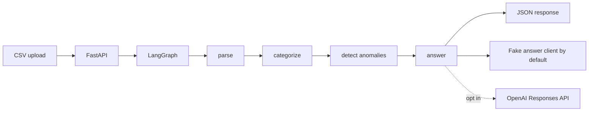

# M-Pesa Statement Agent

A small, runnable portfolio project that analyzes synthetic mobile-money statement CSVs for Kenyan small businesses. It categorizes transactions, flags a few explainable anomalies, and answers grounded questions such as “What did I spend on suppliers in September?”

This is a learning/demo service, not a financial product. The included sample contains synthetic data only. The CSV importer currently supports the documented schema below; it is not an official Safaricom statement importer and does not process PDFs.

## What it does

- Upload a UTF-8 CSV with signed KES amounts.
- Categorize transactions with transparent keyword rules.
- Flag likely duplicate charges, large category-relative spending spikes, and failed reversals.
- Ask questions over the uploaded statement through a typed LangGraph workflow.
- Run locally and in CI with a deterministic fake model and no API key or network calls.
- Optionally use OpenAI for question answering by explicitly selecting the provider.

## Architecture



The graph uses a `TypedDict` state containing the raw CSV, normalized transaction dictionaries, anomalies, and optional question/answer. Parsing, rule-based categorization, anomaly checks, and answer generation are separate nodes. The current repository is in-memory, so uploaded statements disappear when the process restarts.

## Run locally

Requires Python 3.11 or newer.

```bash
python -m venv .venv
source .venv/bin/activate
python -m pip install -e ".[test]"
uvicorn mpesa_agent.main:app --reload --app-dir src
```

Open `http://127.0.0.1:8000/docs` for the interactive API. The deterministic fake client is the default. Upload the included fixture with `POST /statements/upload`, then pass its `statement_id` to `/statements/{statement_id}/analyze` or `/statements/{statement_id}/ask`.

Example question body:

```json
{"question":"What did I spend on suppliers in September?"}
```

## CSV schema

Required columns: `timestamp`, `details`, and `amount`. Optional columns: `reference`, `status`, and `transaction_type`. Amounts are signed decimals: credits are positive and money leaving the account is negative. Timestamps accept ISO 8601 (recommended) and common day-first dates. The importer also handles comma-grouped amounts and parentheses for negatives.

Try `data/samples/synthetic_statement.csv`. It is entirely synthetic; never commit a real statement or API key.

## Optional OpenAI provider

Install the extra and configure credentials locally. The fake provider remains the no-cost default; choosing OpenAI sends statement transaction details to the OpenAI API and may incur usage charges. Do not enable it for sensitive statements without appropriate consent and data-handling review.

```bash
python -m pip install -e ".[openai]"
export APP_LLM_PROVIDER=openai
export OPENAI_API_KEY="your-key-in-your-shell"
export OPENAI_MODEL="gpt-5.5"
```

No key is stored in this repository. OpenAI text generation uses the Responses API and reads the SDK's aggregated `output_text` value.

## Tests and evals

```bash
python -m pip install -e ".[test]"
pytest
python evals/run_evals.py
```

Pytest covers parsing, anomaly behavior, and the HTTP flow. The small deterministic eval set has 20 checks: 10 question-answer expectations and 10 anomaly detection cases. It scores exact expected substrings and expected anomaly types. These are regression checks for this demo, not a claim of production accuracy. GitHub Actions runs both commands for pushes and pull requests.

## How I'd talk about this in an interview

- **Design choice:** Keep financial arithmetic and first-pass categorization deterministic. The model answers language questions over normalized records; it does not invent amounts or decide whether a transaction is a duplicate.
- **Tradeoff:** Keyword categories and simple median-based heuristics are easy to inspect and test, but merchants and real export formats vary. A production system needs user corrections, locale-aware parsers, and calibrated anomaly thresholds.
- **Tradeoff:** In-memory storage keeps the starter small and avoids handling a database before there is a product need, but it is neither durable nor multi-user safe.
- **Tradeoff:** The no-key fake client gives reproducible tests and avoids accidental spend. The optional provider is explicit because sending financial details to a hosted model changes the privacy and cost profile.
- **Next production steps:** Add authentication and ownership checks, durable encrypted storage, data retention/deletion controls, parser fixtures from authorized exports, observability, and a broader human-reviewed evaluation set.

## API

- `POST /statements/upload` — accept a CSV and return a statement ID.
- `POST /statements/{statement_id}/analyze` — parse, categorize, total, and flag anomalies.
- `POST /statements/{statement_id}/ask` — run the same graph with a question.
- `GET /health` — basic process health check.

The service is intentionally unauthenticated and uses process-local storage. Keep it on localhost until you add authentication and tenant isolation.

## License

MIT, see [LICENSE](LICENSE).
